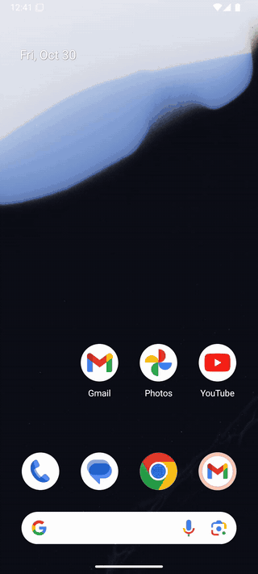

# agent-phone

**Give your AI agent a phone. Get a test suite back.**

[](https://github.com/Rikinshah787/agent-phone/actions/workflows/ci.yml)
[](LICENSE)

Your coding agent can write a mobile app, but it can't see the app run. And when it does click through the app to check something, that work is gone the moment the chat ends.

agent-phone fixes both. One command boots an Android phone your agent drives over [MCP](https://modelcontextprotocol.io), with no Android Studio and no Java. Everything the agent does on the phone can be saved as a test that replays without the agent: on your machine, in CI, forever, for free.

<table>
<tr>
<td width="44%"></td>
<td>

**You:** *"Turn on dark mode and save that as a test."*

The agent drives the phone, then saves this. No AI is needed to run it again:

```yaml
appId: com.android.settings
---
- launchApp:
    appId: com.android.settings
- scrollUntilVisible:
    element: Display & touch
    direction: DOWN
- tapOn: Display & touch
- tapOn:
    id: switchWidget
- assertVisible:
    text: Dark theme
    checked: true
```

```
$ agent-phone test .maestro
  ✓ 1. launchApp (4.0s)
  ✓ 2. scrollUntilVisible (7.5s)
  ✓ 3. tapOn "Display & touch" (3.1s)
  ✓ 4. tapOn id=switchWidget (3.7s)
  ✓ 5. assertVisible "Dark theme" (3.9s)
  PASSED in 22.3s
```

</td>
</tr>
</table>

## Quick start

```bash
# Download the Android pieces and boot a phone
npx -y --allow-git=root github:Rikinshah787/agent-phone setup

# Give Claude Code the phone
claude mcp add phone -- npx -y --allow-git=root github:Rikinshah787/agent-phone mcp
```

Then ask your agent:

> Install `app/build/outputs/apk/debug/app-debug.apk`, sign up with a test email, check the welcome screen appears, and save that as a test called "sign up".

Works with any MCP client: Claude Code, Cursor, Codex, Windsurf and others.

## Explore once, test forever

1. **`phone_test_start`** restarts your app and starts recording.
2. The agent uses the app like a person would. Each tap is recorded by **what was tapped** (its text or id), not where, so tests survive layout changes and different screen sizes. Scrolling to find something is recorded as "scroll until it's visible".
3. **`phone_assert`** checks what should be on screen. Passing checks become assertions.
4. **`phone_test_save`** writes the flow to `.maestro/<name>.yaml` in [Maestro's](https://maestro.dev) open YAML format, so it's readable, diffable and easy to edit by hand.
5. **`phone_test_run`**, or `agent-phone test` in CI, replays it and fails loudly with a screenshot when your app breaks.

## What the agent gets

| Tool | What it does |
| --- | --- |
| `phone_start` | Boot a phone. Pick a device profile, any screen size, any Android version. Installs whatever is missing. |
| `phone_look` | Screenshot plus a numbered list of everything on screen, including dialogs and the keyboard. |
| `phone_tap` | Tap by element number, visible text or coordinates. Long-press too. |
| `phone_type` | Type into a field, optionally clearing it first and pressing Enter after. |
| `phone_scroll` / `phone_swipe` | Scroll precisely (no runaway flings) or drag between two points. |
| `phone_key` | Back, home, recents, enter, volume and more. |
| `phone_open` | Open an app, a URL or deep link, or Settings. |
| `phone_install` | Install an APK, grant its permissions, open it. |
| `phone_app` | List, stop, clear data for, or uninstall apps. |
| `phone_logs` | Logcat for one app, by level, or crashes only. |
| `phone_test_start` / `phone_assert` / `phone_test_save` / `phone_test_run` | Record, check, save and replay tests. |
| `phone_shell`, `phone_list`, `phone_stop` | Escape hatch, devices, shutdown. |

After every action the agent sees the new screen as a short list instead of a screenshot, which is fast and cheap on tokens:

```
App: com.android.settings · screen 576x1280
[9] LinearLayout "Display & touch · Dark theme, font size, touch" @288,873
[12] Switch "Dark theme" id=switchWidget unchecked @517,885
```

If the app crashes, the result starts with `CRASH DETECTED` and the stack trace.

## Run the tests in CI

The phone runs on GitHub's free Linux runners. This repo's own [CI](.github/workflows/ci.yml) boots a phone and replays the example test on every push:

```yaml
- name: Enable KVM
  run: |
    echo 'KERNEL=="kvm", GROUP="kvm", MODE="0666", OPTIONS+="static_node=kvm"' | sudo tee /etc/udev/rules.d/99-kvm4all.rules
    sudo udevadm control --reload-rules && sudo udevadm trigger --name-match=kvm
- run: npx -y --allow-git=root github:Rikinshah787/agent-phone start --headless
- run: npx -y --allow-git=root github:Rikinshah787/agent-phone test .maestro
```

## Any phone

| Profile | Screen | RAM |
| --- | --- | --- |
| `pixel-8` (default) | 1080x2400, 420 dpi | 4 GB |
| `pixel-8-pro` | 1344x2992, 480 dpi | 4 GB |
| `small-phone` | 720x1600, 320 dpi | 2 GB |
| `compact` | 1080x1920, 480 dpi | 3 GB |
| `tablet` | 2560x1600, 320 dpi | 4 GB |

Or pass `width`, `height` and `density` for any other phone, and `android` for any API level (default 35, Android 15). Emulators match a phone's screen, density, memory and Android version, not its manufacturer skin or hardware. Physical Android phones with USB debugging turned on show up too.

## How it works

- Downloads the emulator, platform tools and a system image straight from Google's SDK repository into `~/.agent-phone`, verifying every file. About 2 GB on first run. Downloading means you accept the [Android SDK License](https://developer.android.com/studio/terms).
- Creates virtual devices itself, so no Java or Android Studio is needed. Phones keep running between sessions and restart from a snapshot in about 7 seconds.
- For reliable automation, phones started by agent-phone have animations off, the screen kept awake, and the on-screen keyboard hidden (typing goes through the emulator's hardware keyboard).
- Test files use Maestro's documented selector rules (full-match, case-insensitive text; short or full resource ids) and run on agent-phone's built-in runner. Running them with the Maestro CLI itself hasn't been verified yet.

## Requirements

- Node.js 20.15+ and about 3 GB of disk
- Hardware virtualization: **Windows** with "Windows Hypervisor Platform" on (`agent-phone doctor` checks this and tells you how to fix it), **macOS** works out of the box, **Linux** needs KVM

## CLI

```
agent-phone setup [--device pixel-8] [--android 35] [--no-start]
agent-phone start [device] [--android N] [--headless] [--wipe]
agent-phone test <flow.yaml | folder>... [--serial S]
agent-phone look [serial] [--out screen.png]
agent-phone list | stop [serial] | doctor | mcp
```

## Roadmap

- **iOS**: the same tools driving an iPhone simulator on any Mac you can SSH into.
- **Faster**: each action takes 3-4 s today, mostly Android's `uiautomator dump`. A resident on-device helper should bring that under a second.
- **Build and run**: one tool that builds a Gradle, Expo or Flutter project and installs it.
- Typing non-ASCII text (emoji, accents).

## Contributing

```bash
git clone https://github.com/Rikinshah787/agent-phone && cd agent-phone
npm install            # also builds
node dist/cli.js doctor
```

Opening Claude Code in the repo picks up `.mcp.json`, which points at your local build.

## License

MIT
